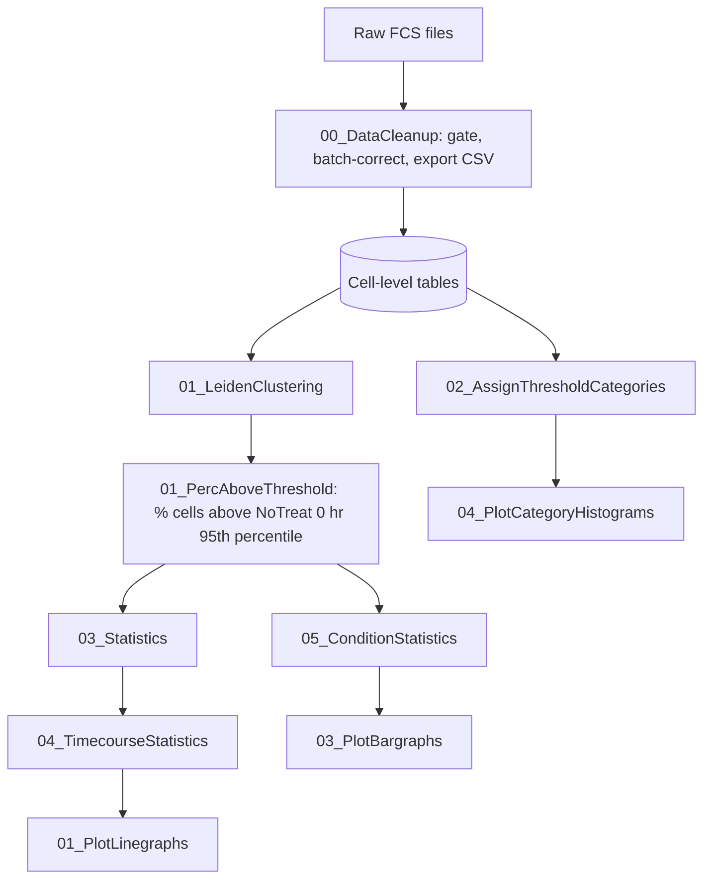

# CyTOF analysis pipeline for Sewell et al. (eLife reviewed preprint RP 111513, revision)

Scripts and records for reproducing the figures. **Work in progress** (2026-11-12): cell-level data tables are not yet attached.

## Where to start
1. `HOW_TO_REPRODUCE.md`: five steps to remake a panel.
2. `figure_recipes/cards/<panel>.md`: for each figure panel, the scripts, versions, settings and file MD5s used.
3. `figure_recipes/Figure_Recipes.csv`: the same as one table. `Panel_Run_Index.csv`: all 48 panels, including schematics and legacy figures.
4. `figure_recipes/Legacy_Figure_Scripts.md`: panels made with scripts that were not modified (scripts in `legacy_scripts/`).

## Pipeline

## Folders
`ScriptsToUse/` revised scripts (one README per layer) · `run_records/` one `run_parameters.json` per final panel (local paths shortened to `~`) · `legacy_scripts/` scripts used unchanged · `figure_recipes/` per-panel documentation.

## Licence
GPL-3.0 (see `LICENSE` at the repository root). `00_DataCleanup/BatchCorrection/02_RunBatch.R` and `03_BatchAdjust.R` contain CytofBatchAdjust code (Schuyler et al. 2019, Front Immunol 10:2367).
